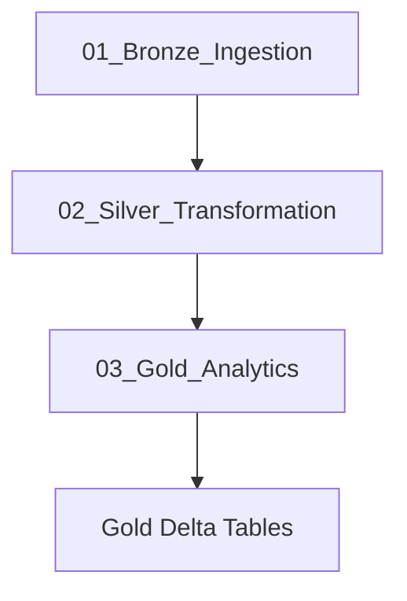

# 🛒 Brazilian E-Commerce Analytics | Databricks & Power BI

> **End-to-end data engineering and business intelligence project using Apache Spark, Databricks, Delta Lake, Medallion Architecture, and Power BI to transform raw e-commerce data into actionable business insights.**

---

## 📌 Project Overview

This project focuses on building an end-to-end e-commerce analytics platform using the **Brazilian E-Commerce Public Dataset by Olist**. The objective is to transform raw transactional data into structured, reliable, and analysis-ready datasets through a scalable data engineering pipeline, followed by interactive business intelligence dashboards.

The project demonstrates the complete data lifecycle — from raw data ingestion and transformation to analytical modeling, aggregation, and visualization.

Using Databricks and Apache Spark, the data is processed through the **Bronze, Silver, and Gold layers of the Medallion Architecture**. The final Gold datasets are connected to Power BI to create an interactive five-page analytics dashboard covering sales performance, customer behavior, product performance, geographic distribution, and delivery logistics.

The project combines data engineering and business analytics to demonstrate how raw data can be converted into meaningful information that supports data-driven business decisions.

---

## 🎯 Project Objectives

- Build an end-to-end data engineering pipeline using Databricks.
- Process multiple relational datasets using Apache Spark.
- Implement the Medallion Architecture for structured data processing.
- Store processed datasets in Delta Lake format.
- Perform data cleaning, transformation, and aggregation.
- Develop business-oriented analytical tables using Spark.
- Create an interactive Power BI dashboard.
- Analyze sales, customers, products, geography, and delivery performance.
- Identify business trends, operational inefficiencies, and growth opportunities.

---

# 📂 1. Dataset Overview

## Brazilian E-Commerce Public Dataset by Olist

The project uses the **Brazilian E-Commerce Public Dataset by Olist**, publicly available through Kaggle.

The dataset contains approximately 100,000 orders placed between **2016 and 2018** through the Olist e-commerce marketplace in Brazil.

It provides information about multiple aspects of an e-commerce business, including orders, customers, products, sellers, payments, reviews, freight charges, delivery timelines, and geographic locations.

Rather than providing a single consolidated dataset, the data is divided into nine separate CSV files. These files are relationally connected through identifiers such as `order_id`, `customer_id`, `product_id`, and `seller_id`.

This structure makes the dataset suitable for developing a real-world data engineering pipeline that involves ingestion, data cleaning, joining, transformation, aggregation, and analytical modeling.

### Dataset Source

- **Dataset Name:** Brazilian E-Commerce Public Dataset by Olist
- **Source:** Kaggle
- **Dataset Period:** 2016–2018
- **Format:** CSV
- **Domain:** E-Commerce, Retail Analytics, Data Engineering, Business Intelligence

🔗 [Access the dataset on Kaggle](https://www.kaggle.com/datasets/olistbr/brazilian-ecommerce)

---

## 📊 2. Dataset Structure

The dataset consists of nine interconnected files.

| Dataset | Description | Business Relevance |
|---|---|---|
| `olist_orders_dataset.csv` | Order IDs, order status, purchase and delivery timestamps | Order tracking and sales performance |
| `olist_customers_dataset.csv` | Customer IDs and customer location information | Customer segmentation and geographic analysis |
| `olist_order_items_dataset.csv` | Product IDs, seller IDs, item prices and freight values | Revenue, product and seller analysis |
| `olist_order_payments_dataset.csv` | Payment types, installment counts and payment values | Payment behavior and financial analysis |
| `olist_order_reviews_dataset.csv` | Review scores, comments and review timestamps | Customer satisfaction analysis |
| `olist_products_dataset.csv` | Product categories, dimensions, weight and product attributes | Product performance and category analysis |
| `olist_sellers_dataset.csv` | Seller IDs and seller geographic information | Seller and marketplace analysis |
| `olist_geolocation_dataset.csv` | Brazilian postal-code prefixes, coordinates, cities and states | Geographic distribution and mapping |
| `product_category_name_translation.csv` | Portuguese product-category names and English translations | Category standardization and reporting |

### Important Data Relationships

The datasets are connected using their respective identifiers:

- Orders → Customers through `customer_id`
- Orders → Order Items through `order_id`
- Orders → Payments through `order_id`
- Orders → Reviews through `order_id`
- Order Items → Products through `product_id`
- Order Items → Sellers through `seller_id`
- Products → Category Translation through product category
- Customers and Sellers → Geolocation through postal-code prefixes

These relationships allow information from multiple datasets to be combined to analyze the business from different perspectives.

---

# 💡 3. Why This Dataset Was Selected

The Olist dataset was selected because it represents a realistic e-commerce business environment and contains sufficient information to perform both data engineering and business analytics.

### 1. Real-World Business Data

The dataset represents actual anonymized e-commerce transactions rather than artificially generated sample data. It includes real business dimensions such as orders, customers, product categories, payments, and delivery performance.

### 2. Multiple Related Datasets

The data is divided into several relational tables, creating an opportunity to demonstrate data integration, joins, schema management, and transformation using Spark.

### 3. Large-Scale Data Processing

The dataset contains a large volume of records, including more than one million geolocation entries in the original dataset. This makes it suitable for demonstrating distributed data processing concepts using Apache Spark.

### 4. Multiple Analytical Dimensions

The dataset supports analysis across several business areas:

- Revenue and sales performance
- Customer purchasing behavior
- Product category performance
- Geographic distribution
- Order and delivery efficiency
- Customer reviews and satisfaction
- Payment patterns

### 5. Business Decision-Making Potential

The dataset enables the identification of business trends, customer behavior patterns, top-performing categories, regional opportunities, and logistics inefficiencies.

### 6. End-to-End Data Engineering Implementation

Its relational structure and diverse data types make it suitable for demonstrating a complete data pipeline using the Medallion Architecture, Delta Lake, Databricks, and Power BI.

---

# 🏗️ 4. Project Architecture

The project follows the **Medallion Architecture**, a layered approach to data engineering in which data is progressively refined from raw records into business-ready analytical datasets.

<pre>
                 ┌─────────────────────────────┐
                 │     OLIST RAW DATASETS      │
                 │       9 CSV FILES           │
                 └──────────────┬──────────────┘
                                │
                                ▼
                 ┌─────────────────────────────┐
                 │       BRONZE LAYER          │
                 │     Raw Data Ingestion      │
                 │                             │
                 │  CSV → Delta Tables         │
                 └──────────────┬──────────────┘
                                │
                                ▼
                 ┌─────────────────────────────┐
                 │       SILVER LAYER          │
                 │  Cleaning & Transformation  │
                 │                             │
                 │  Data Quality               │
                 │  Type Conversion            │
                 │  Standardization            │
                 └──────────────┬──────────────┘
                                │
                                ▼
                 ┌─────────────────────────────┐
                 │        GOLD LAYER           │
                 │  Business Aggregations      │
                 │                             │
                 │  6 Analytics Tables         │
                 └──────────────┬──────────────┘
                                │
                                ▼
                 ┌─────────────────────────────┐
                 │         POWER BI            │
                 │ Interactive Dashboards      │
                 │                             │
                 │ KPIs, Charts, Insights      │
                 └─────────────────────────────┘
</pre>

### Architecture Layers

| Layer | Purpose | Output |
|---|---|---|
| Bronze | Ingest and preserve source data in a structured storage format | Raw Delta tables |
| Silver | Clean, standardize, validate, and transform the data | Cleaned Delta tables |
| Gold | Aggregate and prepare data for analytical use cases | Business-ready analytics tables |
| Power BI | Visualize and interpret business performance | Interactive dashboards |

---

# ⚙️ 5. Data Engineering Workflow

The complete ETL pipeline was implemented in Databricks using Apache Spark and Delta Lake.

The workflow is divided into three notebooks, with each notebook responsible for a specific stage of the pipeline.

---

## 🥉 Bronze Layer — Data Ingestion

**Notebook:** `01_Bronze_Ingestion`

The Bronze layer is responsible for ingesting the original CSV datasets into the Databricks environment and storing them as Delta tables.

### Process

1. Access the raw datasets stored in the Databricks environment.
2. Identify and read the available CSV files.
3. Load the datasets using Spark.
4. Inspect the source data and its schema.
5. Apply appropriate initial data type handling where required.
6. Write the datasets into Delta format.
7. Create the corresponding Bronze tables.

### Technologies Used

- Apache Spark
- PySpark
- Databricks
- Delta Lake
- CSV data ingestion

### Purpose

The Bronze layer establishes the foundation of the data pipeline by bringing the source data into the Databricks Lakehouse environment.

It provides a structured representation of the original datasets that can be used by subsequent transformation processes.

---

## 🥈 Silver Layer — Data Cleaning & Transformation

**Notebook:** `02_Silver_Transformation`

The Silver layer is responsible for improving the quality, consistency, and usability of the ingested data.

Raw datasets may contain inconsistent data types, missing values, duplicate records, formatting issues, or fields that require conversion before analytical use.

### Process

1. Read the Bronze Delta tables.
2. Examine the schema and data types.
3. Perform data cleaning and validation.
4. Convert columns into appropriate data types.
5. Standardize date and timestamp fields.
6. Handle inconsistent or invalid data.
7. Prepare structured datasets for downstream analytics.
8. Write the transformed datasets into Silver Delta tables.

### Transformation Examples

- Converting date columns into timestamp formats.
- Ensuring numerical fields use appropriate data types.
- Standardizing data structures.
- Preparing customer, order, product, payment, review, seller, and geographic datasets for analysis.
- Maintaining consistent schemas for downstream processing.

### Purpose

The Silver layer acts as the quality and transformation layer of the architecture.

It ensures that the data used for analytical calculations is more reliable, consistent, and suitable for aggregation.

---

## 🥇 Gold Layer — Business Analytics & Aggregation

**Notebook:** `03_Gold_Analytics`

The Gold layer transforms the cleaned Silver data into business-oriented analytical datasets.

Instead of working with raw transactional records directly, the Gold layer contains aggregated and structured data designed to support specific analytical use cases.

### Process

1. Read the cleaned Silver datasets.
2. Join the relevant datasets using their relationship keys.
3. Perform business-level aggregations.
4. Calculate metrics related to sales, customers, products, geography, deliveries, and reviews.
5. Organize the results into analytics-specific datasets.
6. Store the final outputs as Gold Delta tables.

### Gold Analytics Tables

| Gold Table | Analytical Focus |
|---|---|
| `gold_sales_analytics` | Revenue, order trends, sales performance and transactional analysis |
| `gold_customer_analytics` | Customer behavior, spending, purchase frequency and customer types |
| `gold_product_analytics` | Product category performance, units sold, revenue and average price |
| `gold_geography_analytics` | Customer geography, cities, states, revenue and customer distribution |
| `gold_delivery_analytics` | Delivery performance, estimated versus actual delivery time, delays and on-time deliveries |
| `gold_review_analytics` | Review scores and customer feedback analysis |

### Purpose

The Gold layer acts as the analytical serving layer.

It reduces the need for complex calculations in Power BI by providing structured, business-ready data that can be directly used for KPI calculations, chart creation, and reporting.

---

# 🔄 6. Automated ETL Pipeline

The three Databricks notebooks were orchestrated using a Databricks Job.

### Job Name

`Ecommerce_Analytics_ETL_Pipeline`

### Execution Sequence



### Pipeline Execution

The pipeline was configured with sequential task dependencies.

- Bronze ingestion executes first.
- Silver transformation executes only after Bronze succeeds.
- Gold analytics executes only after Silver succeeds.

Each task uses a successful completion dependency to ensure that the next stage runs only after the preceding stage completes successfully.

### Benefits of Orchestration

- Automated execution of the entire ETL process.
- Sequential processing of data layers.
- Reduced manual intervention.
- Clear task dependency management.
- Centralized pipeline monitoring.
- Easier identification of failed tasks.
- Reproducible execution of the data workflow.

---

# 📊 7. Power BI Dashboard

The Gold tables were used as the analytical foundation for an interactive Power BI report.

The dashboard is designed to provide business users with an overview of the e-commerce business and allow them to explore specific analytical areas.

The report contains five analytical pages.

---

## Page 1 — Executive Overview

Provides a high-level overview of the overall business performance.

### Key Performance Indicators

- Total Revenue
- Total Orders
- Total Customers
- Average Order Value

### Visualizations

- Monthly Revenue and Order Trends
- Top Product Categories by Revenue Share
- Revenue Performance by Product Category

### Business Purpose

This page allows decision-makers to quickly evaluate the overall performance of the e-commerce business, understand revenue trends, and identify high-performing product categories.

---

## Page 2 — Customer Analytics

Focuses on customer purchasing behavior, customer spending, and customer distribution.

### Key Performance Indicators

- One-time Customers
- Repeat Customers
- Total Customer Spending
- Average Orders per Customer

### Analytical Areas

- Revenue contribution by customer type
- Customer distribution across cities
- Customer spending behavior
- Customer purchasing frequency
- Customer segmentation

### Business Purpose

Helps understand customer value, purchasing patterns, repeat purchasing behavior, and the distribution of customers across different locations.

---

## Page 3 — Product Analytics

Focuses on product and category-level performance.

### Analytical Areas

- Product category revenue
- Units sold
- Average product price
- Product category performance
- Top-performing product categories
- Revenue contribution across product categories

### Business Purpose

Identifies products and categories contributing significantly to revenue and provides insights into product demand and sales performance.

---

## Page 4 — Geography Analytics

Focuses on the geographic distribution of customers and business activity.

### Key Performance Indicators

- Total States
- Total Cities
- Geographic Customers
- Geographic Revenue

### Analytical Areas

- Customer distribution by state
- Geographic revenue distribution
- Customer concentration across regions
- Geographic performance visualization

### Business Purpose

Helps identify important markets, customer concentration areas, and geographic regions that may offer opportunities for expansion.

---

## Page 5 — Delivery & Logistics Analytics

Focuses on order fulfillment and delivery performance.

### Key Performance Indicators

- Average Delivery Days
- On-Time Delivery Percentage
- Late Deliveries
- Average Delay Days

### Analytical Areas

- On-time delivery performance
- On-time versus late deliveries
- Actual delivery time versus estimated delivery time
- Average delivery duration
- Delivery delay analysis

### Business Purpose

Evaluates logistics performance, identifies delivery inefficiencies, highlights possible operational bottlenecks, and helps assess the reliability of the order fulfillment process.

---

# 📈 8. Business Insights & Analytical Value

The project is designed to help answer important business questions.

### Sales & Revenue

- How much revenue is generated by the business?
- How are revenue and order volumes changing over time?
- Which product categories contribute most to revenue?

### Customer Behavior

- How many customers make only one purchase?
- How many customers place repeat orders?
- How much do customers spend?
- What is the average order frequency?

### Product Performance

- Which product categories generate the highest revenue?
- Which categories have the highest sales volume?
- How does product pricing vary across categories?

### Geography

- Which states and cities have the largest customer populations?
- Where is revenue concentrated?
- Which geographic areas represent important markets?

### Delivery & Logistics

- What percentage of orders are delivered on time?
- How many orders experience delivery delays?
- How does actual delivery time compare with estimated delivery time?
- Where might logistics inefficiencies exist?

---

# 🛠️ 9. Technologies & Tools Used

| Technology | Role |
|---|---|
| Databricks | Data engineering and ETL development environment |
| Apache Spark | Distributed data processing |
| PySpark | Data ingestion, transformation and aggregation |
| Delta Lake | Reliable storage of processed data |
| Medallion Architecture | Structured Bronze, Silver and Gold data organization |
| Databricks Jobs | ETL orchestration and task dependency management |
| Unity Catalog / Catalog Explorer | Data organization, exploration and lineage visibility where available |
| Power BI | Interactive data visualization and business intelligence |
| GitHub | Version control and project documentation |

---

# 📁 10. Repository Structure

```text
Ecommerce-Analytics-Databricks/
│
├── notebooks/
│   ├── 01_Bronze_Ingestion.ipynb
│   ├── 2_Silver_Transformation.ipynb
│   └── 3_Gold_Analytics.ipynb
│
├── README.md
│
└── [Dashboard Screenshots]
```

### Notebook Description

| Notebook | Responsibility |
|---|---|
| `01_Bronze_Ingestion.ipynb` | Raw data ingestion and Bronze table creation |
| `2_Silver_Transformation.ipynb` | Data cleaning, type conversion and Silver transformation |
| `3_Gold_Analytics.ipynb` | Business aggregations and Gold analytics table creation |

---

# 🚀 11. Project Execution Workflow

The overall project workflow can be summarized as follows:

### Step 1 — Dataset Acquisition

Download the nine CSV datasets from the Olist Brazilian E-Commerce dataset available on Kaggle.

### Step 2 — Data Ingestion

Upload or make the raw files available in the Databricks environment.

### Step 3 — Bronze Processing

Run the Bronze ingestion notebook to load raw CSV files and create Bronze Delta tables.

### Step 4 — Silver Transformation

Run the Silver notebook to clean, standardize, and transform the Bronze datasets.

### Step 5 — Gold Analytics

Run the Gold analytics notebook to create six business-oriented analytics tables.

### Step 6 — Pipeline Orchestration

Execute the Databricks Job to run all three notebooks sequentially.

### Step 7 — Power BI Integration

Connect Power BI to the analytical Gold datasets and create the dashboard pages.

### Step 8 — Business Analysis

Use KPIs, visualizations, and filters to analyze business performance and identify insights.

---

# 📌 12. Project Outcome

The project successfully demonstrates the development of an end-to-end e-commerce data analytics solution.

Raw datasets are ingested into Databricks, transformed through the Bronze and Silver layers, and aggregated into six Gold analytics tables. These structured outputs provide the foundation for an interactive Power BI dashboard covering five major business areas.

The solution demonstrates how data engineering workflows can transform raw data into structured analytical information that supports business reporting and decision-making.

### Final Deliverables

- 9 source datasets
- Bronze Delta tables
- Cleaned Silver datasets
- 6 Gold analytics tables
- 3 Databricks notebooks
- Automated sequential ETL Job
- 5-page Power BI dashboard
- GitHub repository for version control and documentation

---

# 🔮 13. Future Enhancements

Potential improvements that can extend the project further include:

- Implementing data quality checks and automated validation rules.
- Adding incremental data ingestion instead of full refreshes.
- Implementing Slowly Changing Dimensions (SCD) where applicable.
- Improving cross-table filtering and data model relationships in Power BI.
- Adding advanced customer segmentation.
- Performing customer churn and retention analysis.
- Implementing sales forecasting using machine learning.
- Adding sentiment analysis on customer review text.
- Implementing automated alerts for delivery delays or performance changes.
- Deploying a more production-oriented monitoring and logging framework.

---

# 👥 14. Team Project

This project was collaboratively developed with a focus on data engineering, data transformation, analytics, visualization, and project integration.

All team members contributed to the development and understanding of the overall solution. The project was designed so that each stage of the pipeline could be explained in terms of its purpose, implementation, and contribution to the final analytical output.

---

# 👨‍💻 15. Author

**Mohit Sharma**

B.Tech — Computer Science Engineering  
Artificial Intelligence & Machine Learning

### Project

**E-Commerce Analytics using Databricks & Power BI**

---

# 📚 16. References

- [Olist Brazilian E-Commerce Public Dataset — Kaggle](https://www.kaggle.com/datasets/olistbr/brazilian-ecommerce)
- [Databricks Documentation](https://docs.databricks.com/)
- [Apache Spark Documentation](https://spark.apache.org/docs/latest/)
- [Power BI Documentation](https://learn.microsoft.com/en-us/power-bi/)

---

<p align="center">

**Built with Databricks • Apache Spark • Delta Lake • Power BI**

*Transforming raw e-commerce data into actionable business intelligence.*

</p>
